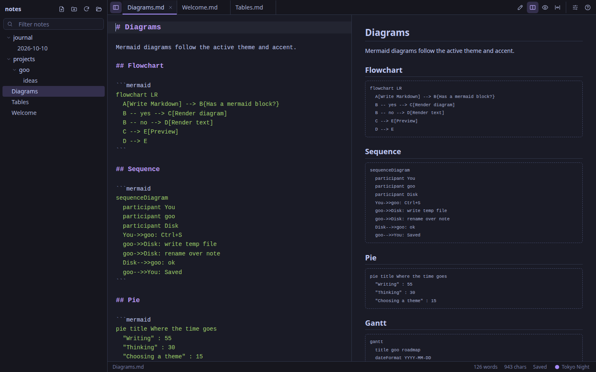
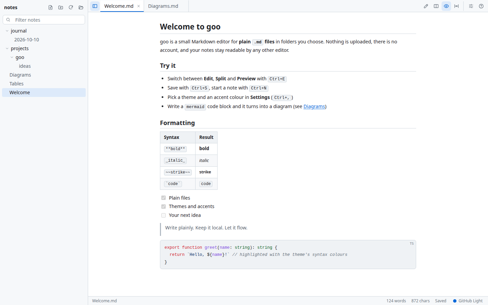
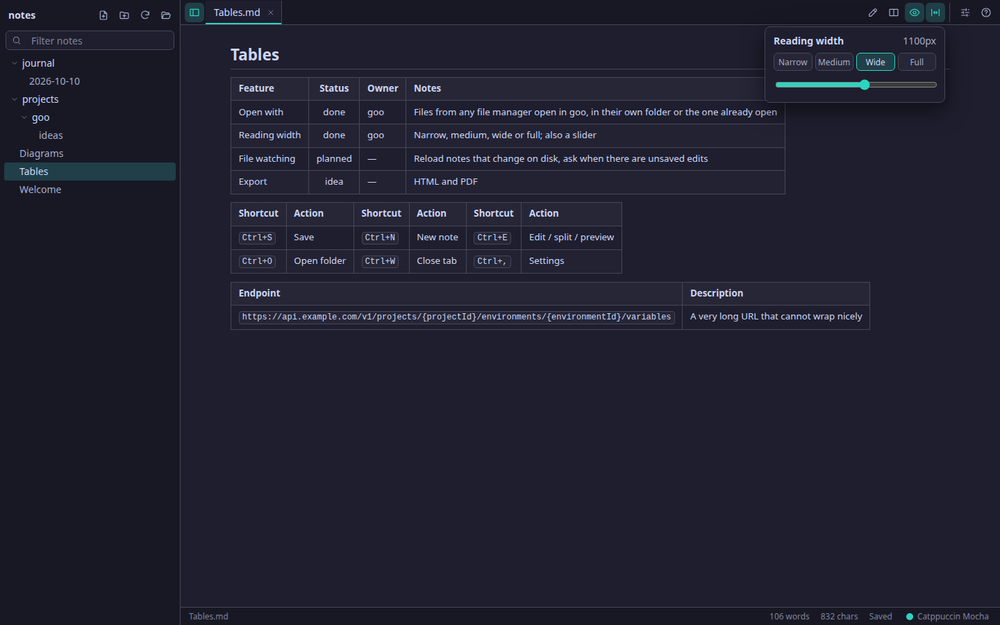
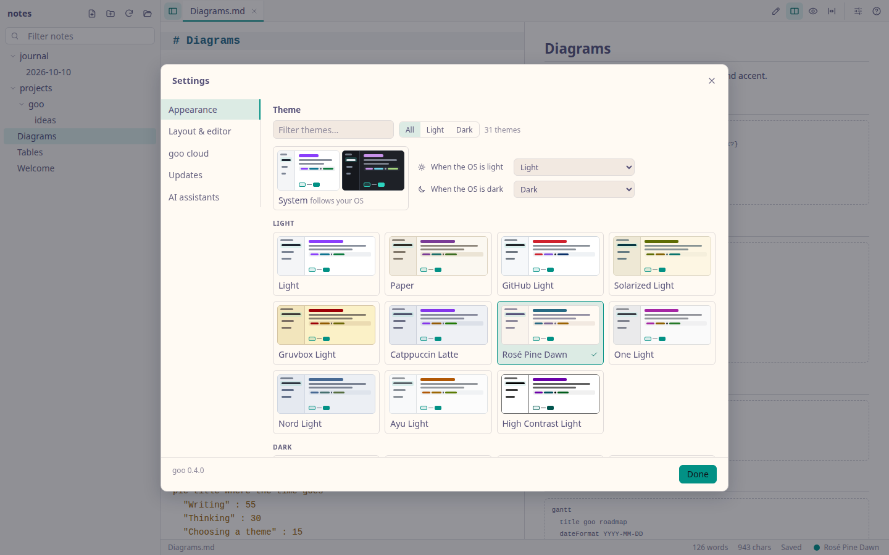
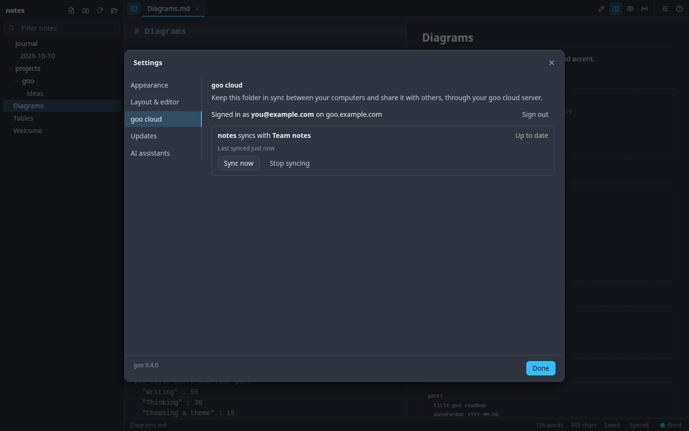
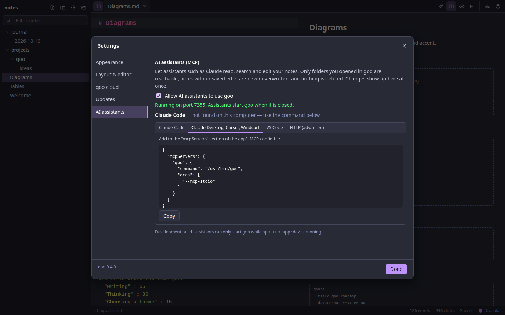
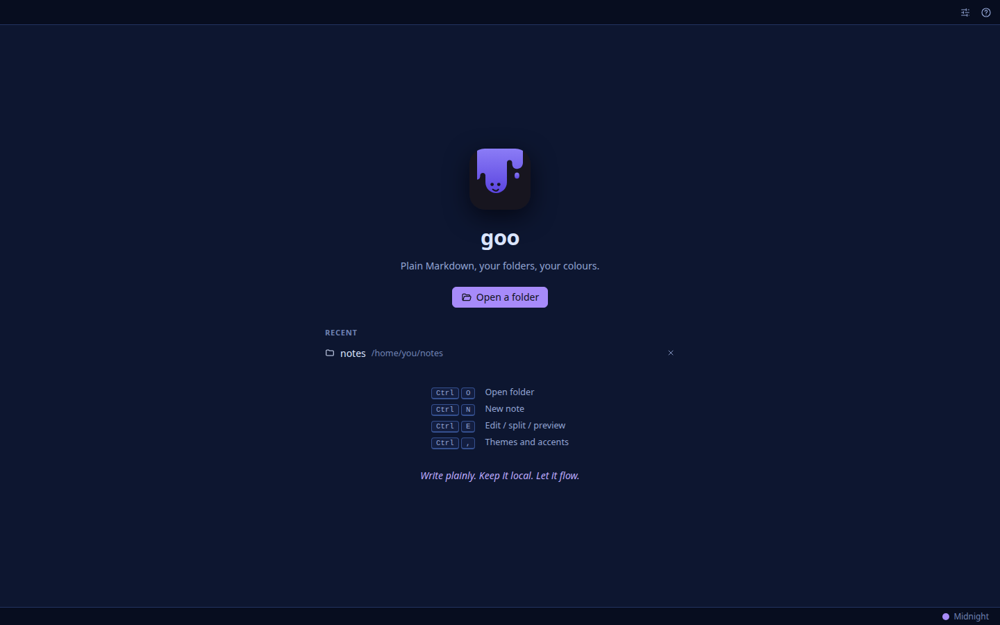
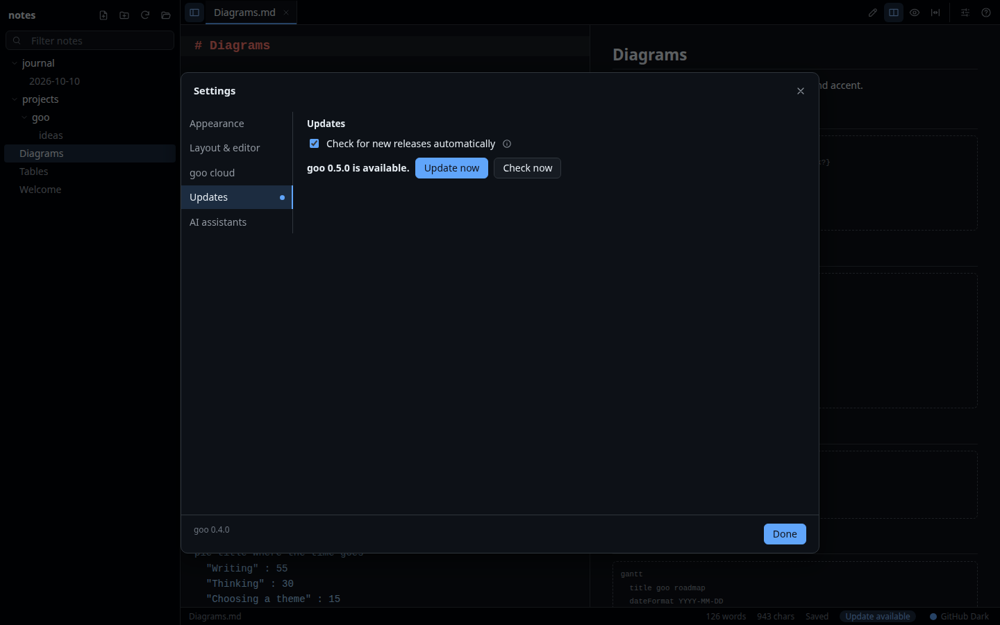

# goo

A small, local-first Markdown editor for **plain `.md` files in folders you choose**, with live preview,
**Mermaid diagrams**, and **31 themes × 18 accent colours**. Built with Tauri 2 (Rust) and Svelte 5.
No account, no telemetry, nothing uploaded.

Plain Markdown, your folders, your colours: read [the Goo Manifesto](#manifesto).



**Download:** [latest release](https://github.com/perunok/goo/releases/latest): Linux (`.deb`, `.rpm`, AppImage;
x64 and arm64), macOS (`.dmg`; Apple silicon and Intel), Windows (`.exe`, `.msi`).

On Linux the package and command are called **`goo-notes`** (Debian/Ubuntu already have an unrelated package `goo`, the
GOO programming language). If you installed goo 0.1–0.3 from a `.deb`, Ubuntu's automatic updates may have replaced it
with that package: install `goo-notes` and remove the other one with `sudo apt remove goo`.

## Screenshots

| | |
|---|---|
| <br>**Preview** with tables, task lists and code, in any of 31 themes | <br>**Reading width** (narrow to full) and tables that size to their content |
| <br>**31 themes × 18 accents**, each pair checked for contrast | <br>**goo cloud**: sync a folder between computers and share it |
| <br>**AI assistants (MCP)**: Claude and others work with your notes | <br>**Welcome**: open a folder, or a recent one |
| <br>**In-app updates**: check, download, verify and install from Settings | |

Regenerate them with `npm run dev` and `npm run screenshots`.

## Features

- **Folders, not databases.** Open any folder: goo lists its Markdown files (`.md`, `.markdown`) as a tree, with a
  keyword search (`Ctrl+F`: notes whose name or text has every word, with the matching lines). Right-click to create notes and folders, rename (F2), delete (Del) or show in the file manager; drag
  notes and folders to move them. Deleting moves things to the system trash, so it can be undone. Notes are saved as plain UTF-8 files with atomic writes (temp file + rename), so a crash never leaves
  half a note behind.
- **Edit, split or preview** (`Ctrl+E`): a CodeMirror 6 editor with Markdown highlighting (and highlighting inside
  fenced code), next to a live GitHub-flavoured preview: tables, task lists, strikethrough, heading
  anchors, front matter shown as a block, syntax-highlighted code.
- **Mermaid diagrams**: a ` ```mermaid ` block becomes a diagram (flowchart, sequence, class, state, ER, Gantt, pie,
  git graph, …), drawn in the current theme and accent colours and redrawn when you switch. Parse errors are shown
  inline with the source.
- **Themes and accents** shared with [Slinger](https://github.com/perunok/slinger): 31 light and dark palettes,
  18 accents layered over any of them, "follow the system", adjustable font size. Every theme × accent pair is
  checked for WCAG AA contrast (AAA for the high-contrast themes) by the test suite.
- **Tabs** with per-tab undo history, unsaved markers and save prompts; right-click a tab to close it, the others or
  all of them. The last folder and open notes come back on the next start.
- **Notices outside changes**: when another program (another editor, `git pull`, Claude Code, a sync tool) changes a
  note, goo reloads it and refreshes the tree. If you have unsaved edits they stay, and saving asks whether to keep
  yours or load theirs.
- **Open with goo** from any file manager (or `goo-notes notes.md` on Linux), or **Open note** in goo (`Ctrl+Shift+O`):
  the note opens in its folder; a selection of notes opens as tabs in the one goo window.
- **Reading width**: narrow, medium, wide or full, for the preview and the editor.
- **Links between notes**: `[see this](../other.md#section)` opens the other note and scrolls to the heading. Web
  links open in your browser.
- **AI assistants (MCP)**: turn on Settings > AI assistants and Claude (Code or Desktop), Cursor, VS Code and other
  MCP clients can read, search, create and edit your notes, see the note you have open (with your selection), check
  that their Mermaid diagrams render, and sync with goo cloud. See [AI assistants](#ai-assistants-mcp).
- **goo cloud** (optional, self-hosted [goo-cloud](https://github.com/perunok/goo-cloud) server): sync a folder
  between your computers and share it, with line-by-line merging of edits made on two devices and conflict copies
  instead of lost text. Settings > goo cloud.
- **Updates inside the app**: goo checks GitHub for a newer release once a day (switch it off in Settings > Updates),
  shows one notification per version, and **Update now** downloads the installer, verifies it against GitHub's
  SHA-256 and size, and installs it when you restart: AppImage replaced in place, `.deb` through the system's
  password prompt (`pkexec`), Windows installer silently, macOS app bundle swapped. Installs it cannot update itself
  (`.rpm`, `.msi`, development builds) get a **View release** link instead. Unsaved notes are saved or kept first.
  Set `GOO_UPDATES=off` to disable all checks; `GOO_UPDATE_FEED_URL` points them at another feed (tests).
- **Safe by default**: rendered notes are sanitised (no scripts, no event handlers, no remote content), Mermaid runs
  in `strict` mode, and the Rust side refuses any file path outside the folder you opened.

## AI assistants (MCP)

goo has a built-in [MCP](https://modelcontextprotocol.io) server, **off until you turn it on** in Settings > AI
assistants (MCP). There you can connect Claude Code with one click, or copy a ready-made config for Claude Desktop,
Cursor, Windsurf, VS Code or any Streamable-HTTP client. Assistants run `goo-notes --mcp-stdio` (Linux; `goo` on macOS and
Windows), which talks to the open goo
(and starts it if it is closed).

| Tool | What it does |
| --- | --- |
| `list_workspaces` | Folders you opened in goo, and which one is open |
| `list_notes`, `read_note`, `search_notes` | Browse, read and search notes |
| `create_note`, `edit_note`, `append_to_note`, `write_note` | Create and change notes (missing folders are created) |
| `open_in_app` | Show a note in the goo window |
| `move_note`, `delete_note` | Rename or move a note (folders are created); delete moves it to the system trash |
| `get_open_note` | The note on screen as you see it, unsaved edits and selection included ("fix this paragraph") |
| `check_mermaid` | Checks diagrams with goo's own Mermaid renderer (a note's blocks or a snippet): line and error for each |
| `sync_status`, `sync_now` | goo cloud: last sync, conflicts to resolve, notes that could not sync; sync immediately |

Rules: only folders you opened in goo are reachable, paths cannot leave them, notes with unsaved edits in goo are
never written, moved or deleted, and deleting only moves a note to the system trash (marked destructive, so your
assistant asks you first). Changes show up in goo at once, and in a synced folder they go to goo
cloud right away. The endpoint listens on `127.0.0.1` only, needs a token (Settings can issue a new one) and turns
away browser requests.

**Why MCP when an assistant can edit files itself?** Assistants without file access (Claude Desktop, chat apps) get
your notes at all; every assistant gets what only goo knows (the note on screen with unsaved text and selection,
whether diagrams really render, sync state and conflicts) and goo's safety rules (no writes over your unsaved edits,
only your note folders, deletes go to the trash). Direct file edits by tools like Claude Code also work: goo notices them.

## Keyboard

| Keys | Action |
| --- | --- |
| `Ctrl+O` | Open folder |
| `Ctrl+Shift+O` | Open note (opens its folder too, unless it is in the open one) |
| `Ctrl+N` | New note |
| `Ctrl+F` | Search notes by keywords (in the editor: find and replace in the note; `Ctrl+Shift+F` searches notes from there) |
| `Ctrl+S` / `Ctrl+Shift+S` | Save / save all |
| `Ctrl+W`, `Ctrl+Tab` | Close tab, next tab |
| `Ctrl+E` | Cycle edit / split / preview |
| `Ctrl+\` | Toggle sidebar (drag its edge to resize or close it, double-click the edge to reset) |
| `Ctrl+,` | Settings (appearance, layout, goo cloud, updates, AI assistants) |
| `Ctrl+=` / `Ctrl+-` / `Ctrl+0`, `Ctrl+scroll` | Font size of the page (the sidebar, tabs and status bar stay as they are) |
| `Ctrl+B` / `Ctrl+I` / `Ctrl+K` | Bold / italic / link (in the editor) |
| `F2` / `Del` (in the tree) | Rename / delete (to the trash) the selected note or folder |

## Getting started

Requirements: Node.js 20+, Rust (stable), and the [Tauri prerequisites](https://tauri.app/start/prerequisites/)
for your OS. On Debian/Ubuntu:

```bash
sudo apt install libwebkit2gtk-4.1-dev libdbus-1-dev build-essential curl wget file libxdo-dev libssl-dev libayatana-appindicator3-dev librsvg2-dev
```

Then:

```bash
npm install
npm run app:dev       # the desktop app with hot reload
npm run dev           # just the UI in a browser at http://localhost:1420, with an in-memory sample folder
npm run app:build     # installers for the current OS into target/release/bundle/
```

Checks:

```bash
npm run typecheck     # svelte-check
npm test              # Vitest: renderer, themes (contrast of every theme x accent), paths, settings, outside changes
npm run test:rust     # goo-core, goo-mcp, goo-sync, goo-update: files, path guarding, MCP, sync, update check/install
```

## Releases

Installers are built by GitHub Actions ([`.github/workflows/release.yml`](.github/workflows/release.yml)) for
Linux (x64 + arm64: AppImage, deb, rpm), macOS (Apple silicon + Intel: dmg) and Windows (x64: exe, msi), named like
Slinger's: `goo-0.2.0-linux-amd64.deb`, `goo-0.2.0-mac-arm64.dmg`, `goo-0.2.0-win-x64.exe`
([`scripts/release-assets.mjs`](scripts/release-assets.mjs)).

```bash
npm version 0.2.0 --no-git-tag-version   # bump package.json (Cargo/Tauri read it from there)
git commit -am "Release 0.2.0"
git tag -a v0.2.0 -m "goo 0.2.0"
git push --follow-tags
```

The tag builds everything and attaches it to a **draft** release; publish it on GitHub when it looks right. Running
the workflow by hand (Actions > Release > Run workflow) builds the same installers as downloadable artifacts without
a release. Builds are not code-signed yet (macOS: right-click > Open the first time; Windows: SmartScreen > Run anyway).

## How it is built

```
src/                 Svelte 5 UI (TypeScript)
  app/               shell, stores (workspace, settings, ui), shortcuts
  backend/           GooBackend interface: tauri.ts (Rust commands) and mock.ts (browser dev mode)
  components/        editor (CodeMirror), markdown (render, highlight, mermaid, view), ui
  features/          files (sidebar, tree, tabs, status bar, welcome), settings, updates, about
  lib/               pure logic: themes, appearance, contrast audit, paths
  styles/themes.css  every colour in the app (31 themes, 18 accents)
src-tauri/           the Tauri shell: window, plugins and the commands the UI calls
crates/goo-core/     file logic in plain Rust (no Tauri), unit-tested on its own
crates/goo-mcp/      MCP server: note tools, localhost endpoint, `goo --mcp-stdio` bridge (no Tauri)
crates/goo-sync/     goo cloud sync engine: scan, 3-way merge, pull/push, device sign-in (no Tauri)
crates/goo-update/   in-app updates: GitHub release check, install detection, download + verify, per-OS install (no Tauri)
```

- The UI never touches the disk itself; it calls a handful of commands (`list_tree`, `read_file`, `write_file`,
  `create_file`, …). The Rust side keeps the open folder and checks every path against it (symlinks resolved), and
  only reopens folders the user picked before.
- Colours live only in `src/styles/themes.css`; components use `var(--token)`. Mermaid gets the same palette,
  resolved to hex at render time.
- The UI runs in any browser with `npm run dev`; `src/backend/mock.ts` stands in for the Rust side with sample notes.

## Roadmap

- Local images next to notes
- Outline panel, quick open (`Ctrl+P`), command palette
- Export to HTML / PDF
- Custom themes (as in Slinger)

## Manifesto

**The Goo Manifesto**

1. **Plain text outlives every app.** Your notes are .md files in folders you choose. Open them with anything, forever.
2. **Small and quick.** No account, no telemetry, ready in a blink.
3. **Yours, on your disk.** Nothing leaves your machine unless you move it.
4. **Words first.** The editor is the source of truth; the preview just follows.
5. **Diagrams are text too.** Mermaid lives in your notes as code you can diff and review.
6. **Take the shape of the container.** Themes, accents and layouts: goo fits the way you work.
7. **Nothing runs that you didn't write.** Rendered notes can't run scripts or fetch from the web behind your back.
8. **Anyone can pour some goo.** Open source, MIT licensed, built in the open, yours to fork.

*Write plainly. Keep it local. Let it flow.*

The same text is in the app (About goo); it lives in `src/features/about/credits.ts`, so keep the two in step.

## License

[MIT](LICENSE)
